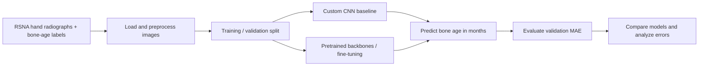
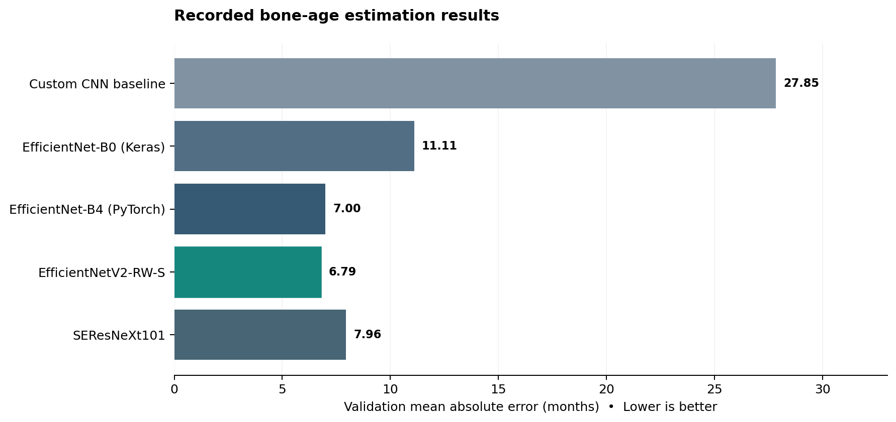
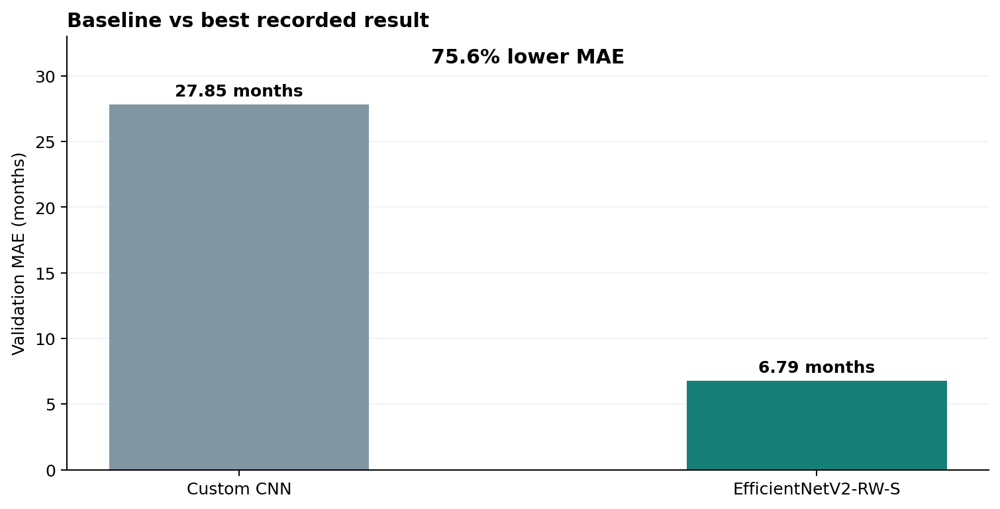

# Pediatric Bone Age Estimation Using Deep Learning

   

## Motivation and problem

**Bone age** describes skeletal maturity rather than simply a child's chronological age. Radiologists assess hand and wrist radiographs to support evaluation of growth and development. Manual assessment takes time and is subject to reader variability.

**Research question:** Can convolutional neural networks and transfer learning estimate pediatric bone age from hand X-rays more accurately than a small CNN trained from scratch?

This project compares a custom CNN with pretrained image backbones on the **RSNA Pediatric Bone Age** dataset. It studies the impact of transfer learning, fine-tuning, image preprocessing and (in selected models) patient sex as an additional input. It is a research prototype, **not a clinical diagnostic tool**.

## Approach



The notebooks contain separate experiments using PyTorch and TensorFlow/Keras, including custom CNN, EfficientNet variants, SEResNeXt101 and a region-based ConvNeXtV2 exploration. Some architectures combine imaging features with recorded sex. These experiments use **different training splits, image resolutions and preprocessing choices**, so the comparison is descriptive rather than a tightly controlled head-to-head study.

## Results

**Main answer:** Transfer learning produced substantially lower validation error than the custom CNN baseline in the recorded experiments. The best evaluated model was **EfficientNetV2-RW-S**, with **6.79 months validation MAE**, versus **27.85 months** for the basic CNN (~75.6% reduction). MAE is the average absolute difference between predicted and annotated bone age; lower is better.





| Experiment | Reported validation MAE (months) | Notebook |
|---|---:|---|
| Custom CNN baseline | 27.85 | `simple-cnn.ipynb` |
| EfficientNet-B0, fine-tuned (Keras) | 11.11 | `models.ipynb` |
| EfficientNet-B4 (PyTorch) | 7.00 | `models.ipynb` |
| SEResNeXt101 | 7.96 | `models.ipynb` |
| **EfficientNetV2-RW-S** | **6.79** | `models.ipynb` |

*Values are taken from saved notebook cell outputs, not re-trained or simulated. The chart is derived from those recorded values. Experimental settings differ between notebook sections; results are not an independent clinical test-set evaluation.*

## Repository layout

```text
.
├── README.md
├── requirements.txt
├── assets/
│   ├── model_comparison.png
│   └── baseline_improvement.png
├── notebooks/
│   ├── simple-cnn.ipynb       # Baseline and region-based exploration
│   ├── basicis.ipynb          # Dataset EDA and additional models
│   └── models.ipynb           # Backbone training, evaluation, comparisons
└── scripts/
    └── prepare_notebooks.py  # Converts Kaggle paths to local paths
```

## Run the notebooks

**Prerequisites:** Python 3, a Jupyter environment, sufficient GPU memory for model training, and the [RSNA Bone Age dataset](https://www.kaggle.com/datasets/kmader/rsna-bone-age). The dataset and pretrained weights are not bundled. Notebook sections download pretrained weights and can take substantial time to train.

From the **repository root**:

```bash
python -m venv .venv
source .venv/bin/activate        # Windows PowerShell: .venv\Scripts\Activate.ps1
python -m pip install -r requirements.txt
```

Download and extract the dataset so the relative paths look like this:

```text
data/rsna-bone-age/
├── boneage-training-dataset.csv
├── boneage-training-dataset/
│   └── boneage-training-dataset/
│       └── <image-id>.png
├── boneage-test-dataset.csv           # Needed only for test-data sections
└── boneage-test-dataset/
    └── boneage-test-dataset/
        └── <image-id>.png
```

Prepare locally runnable notebook *copies* (the originals use Kaggle-specific absolute paths):

```bash
mkdir -p checkpoints
python scripts/prepare_notebooks.py
jupyter lab
```

Open `notebooks_local/simple-cnn.ipynb` to run the baseline, `notebooks_local/basicis.ipynb` for EDA and early model tests, or `notebooks_local/models.ipynb` for transfer-learning experiments. **Run only the desired experiment section and its prerequisite cells**: `models.ipynb` is an exploratory notebook with multiple independent training runs, reused variables and checkpoint-loading cells, not a single top-to-bottom automated pipeline. Some cells require checkpoints produced by earlier training sections. GPU-dependent sections may not run on CPU without changes.

On **Kaggle**, you can instead attach the RSNA dataset and run the original notebooks directly using their existing `/kaggle/input/...` paths. The included relative-path preparation script has not been end-to-end training-tested in a fresh environment.

## Limitations and next steps

- Different model sections use different data splits and training protocols; re-run all candidates on one fixed split for a rigorous comparison.
- Report test-set performance, confidence intervals and error breakdowns by age range and sex before drawing generalization conclusions.
- Perform explainability/error analysis and external clinical validation before considering any medical use.

## Source

The results and implementation descriptions above were extracted from the **three notebooks in the supplied project ZIP**. The PowerPoint file was intentionally excluded.
